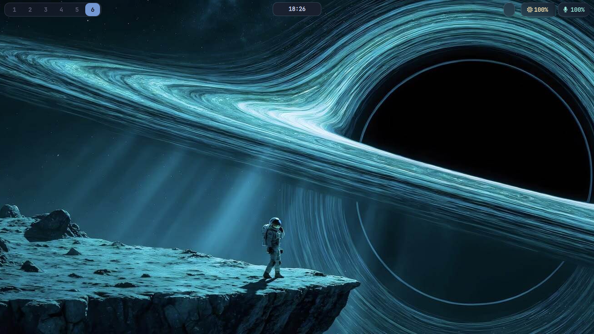
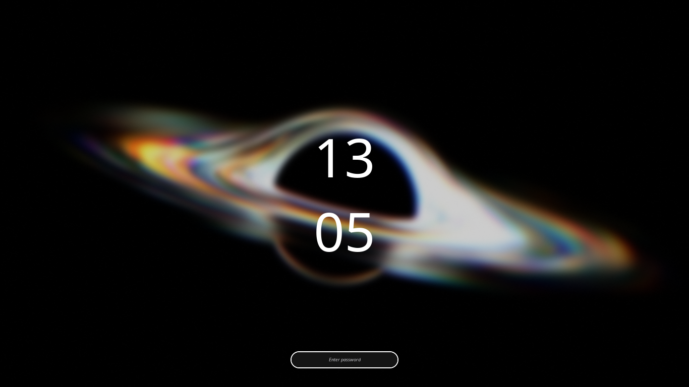
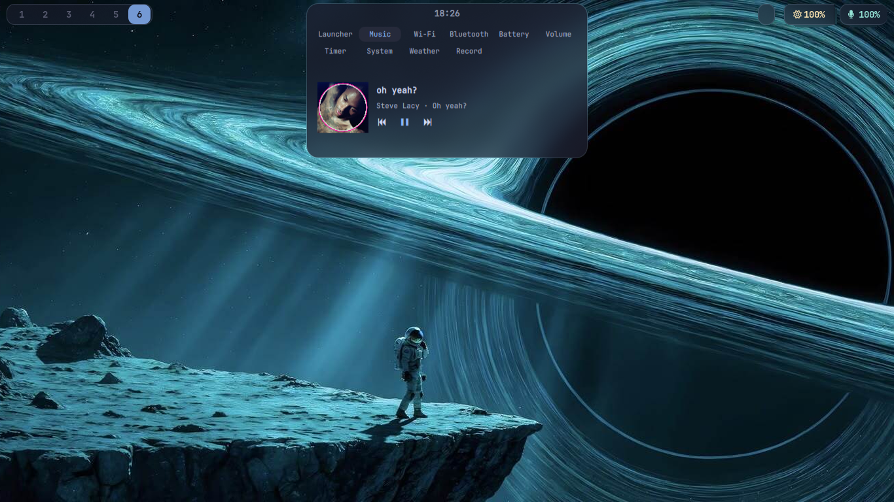
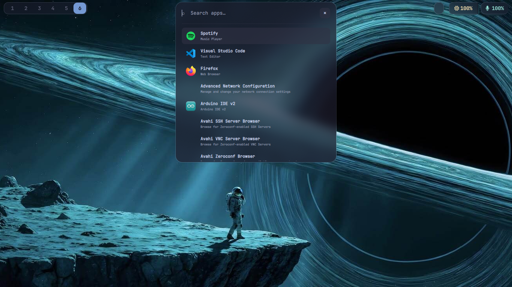
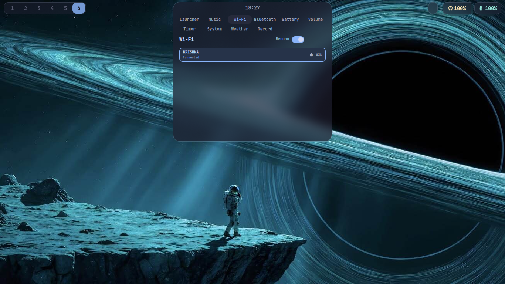
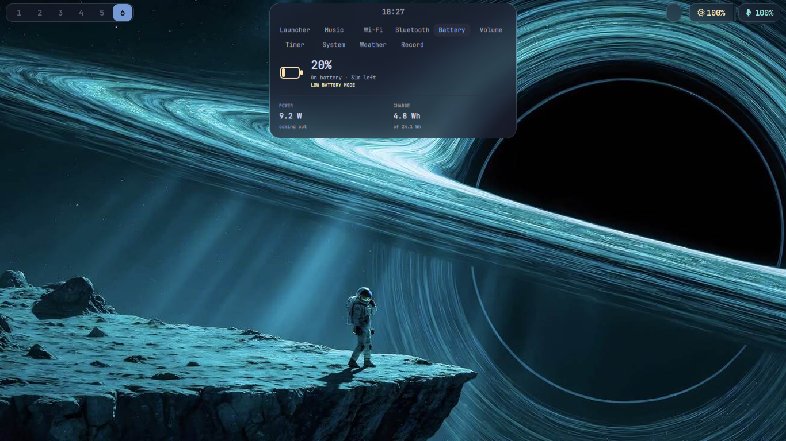
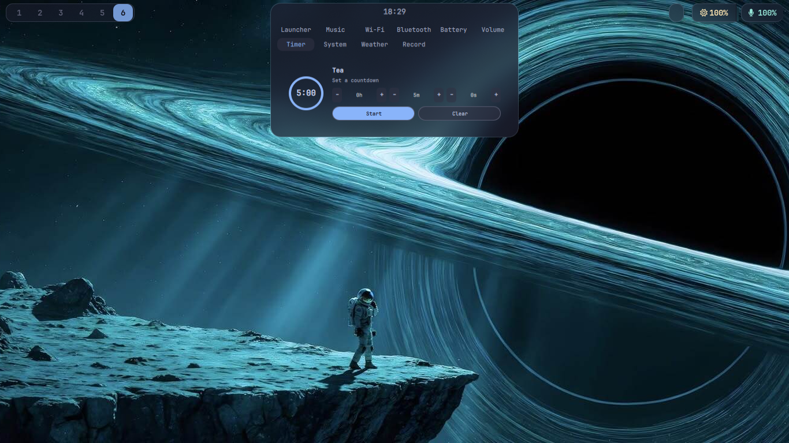
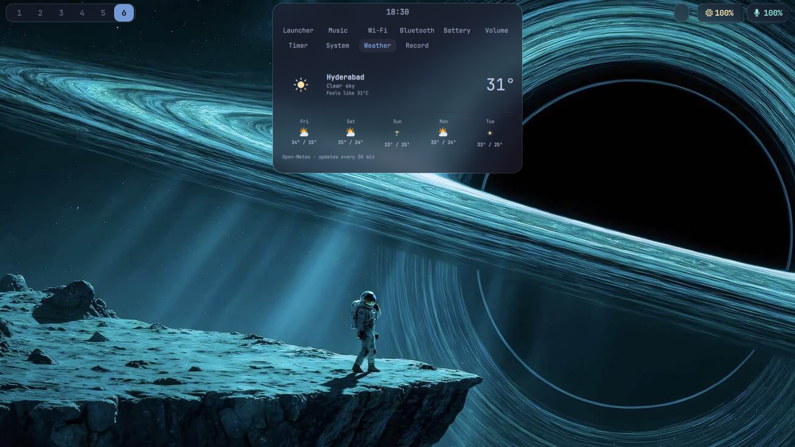
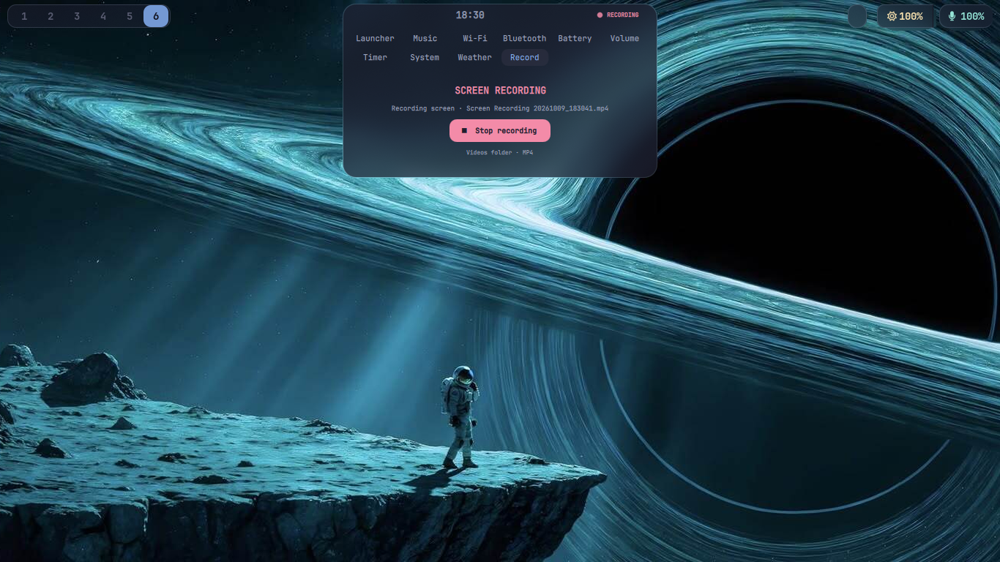

<div align="center">

# Event Horizon

**A Hyprland desktop on Arch Linux, with a dynamic island that grows into whatever you need.**



<br>


[The island](#the-island) · [Gallery](#gallery) · [Install](#install) · [Keybindings](#keybindings) · [What's inside](#whats-inside)

</div>

---

## About

Event Horizon is my Arch Linux rice for Hyprland: a custom Waybar for
workspaces and status, and an expandable **Quickshell island** at the top of
the screen.

The island sits as a small clock pill. Hover and it opens into a launcher,
music player, Wi-Fi manager, system monitor and more. When you are done it
shrinks back to the pill. Notifications show up there too.

## The island

Built with [Quickshell](https://quickshell.org). Hover to expand it, or drive
it from Hyprland keybindings through Quickshell IPC.

| Panel | What it does |
|---|---|
| **Launcher** | Search installed apps and launch them. Recently used apps come first. |
| **Music** | Track title, artist and album art, with previous / play-pause / next. |
| **Wi-Fi** | List networks, rescan, connect, and toggle the radio. |
| **Bluetooth** | Adapter status, connected devices, and a power toggle. |
| **Battery** | Charge level, time remaining, power draw and energy in Wh. |
| **Volume** | Output volume slider, speaker mute and microphone mute. |
| **Timer** | Set a countdown, then pause, resume, restart or stop it. |
| **System** | Live CPU and memory graphs. |
| **Weather** | Current conditions and a five-day forecast from Open-Meteo. |
| **Record** | One-click screen recording to MP4 in your Videos folder. |

## Gallery

<p align="center">
  
  <br><sub><b>Hyprlock</b> · lock screen across both displays</sub>
</p>

<table>
  <tr>
    <td width="50%"><br><sub><b>Music</b> · now playing with controls</sub></td>
    <td width="50%"><br><sub><b>Launcher</b> · fuzzy app search</sub></td>
  </tr>
  <tr>
    <td width="50%"><br><sub><b>Wi-Fi</b> · networks and signal strength</sub></td>
    <td width="50%"><br><sub><b>Battery</b> · charge, time left, power draw</sub></td>
  </tr>
  <tr>
    <td width="50%"><br><sub><b>Volume</b> · output and mic</sub></td>
    <td width="50%"><br><sub><b>Timer</b> · quick countdowns</sub></td>
  </tr>
  <tr>
    <td width="50%"><br><sub><b>System</b> · CPU and memory history</sub></td>
    <td width="50%"><br><sub><b>Weather</b> · five-day forecast</sub></td>
  </tr>
  <tr>
    <td colspan="2" align="center"><br><sub><b>Record</b> · live recording indicator in the island header</sub></td>
  </tr>
</table>

## Install

> The installer sets up **the island only**, not the whole rice. The other
> dotfiles are there for you to read and adapt.

> **Before installing:** this repository does not set up a complete desktop or
> window-manager environment. It is designed for Hyprland, so install and
> configure Hyprland first. The island installer will not make the desktop
> usable on its own.

**Requirements**

- Arch Linux with Hyprland
- Quickshell and PipeWire
- NetworkManager and UPower
- `curl`, `power-profiles-daemon`, `wf-recorder`, `libnotify`

The installer offers to install anything missing with `pacman`.

**Steps**

```bash
git clone <your-repository-url> event-horizon
cd event-horizon
./install-dynamic-island.sh
```

The script will:

1. Offer to install missing packages.
2. Copy the config to `~/.config/quickshell/island/`.
3. Add a startup line to your Hyprland config if one is not already there.

Existing island config and Hyprland startup files are backed up with a
timestamp before anything is changed.

Log out and back in, or start it right away:

```bash
quickshell --no-duplicate --path "${XDG_CONFIG_HOME:-$HOME/.config}/quickshell/island/shell.qml"
```

## Keybindings

The island can be controlled from Hyprland binds via Quickshell IPC, for
example to open the launcher, show notifications, or control audio. These
commands work in a terminal and can also be added to `hyprland.conf`:

```bash
ISLAND="${XDG_CONFIG_HOME:-$HOME/.config}/quickshell/island"
quickshell --path "$ISLAND" ipc call island openLauncher
quickshell --path "$ISLAND" ipc call island toggleNotifications
quickshell --path "$ISLAND" ipc call island toggleMute
quickshell --path "$ISLAND" ipc call island volumeDown
quickshell --path "$ISLAND" ipc call island volumeUp
```

## Notes

- **Weather** location is estimated from your IP address.
- Wi-Fi, weather, power profiles, notifications, audio and recording each
  need their service or device to be present.
- The AI chat feature has been removed.

## What's inside

| Path | Contents |
|---|---|
| `quickshell/island/shell.qml` | The island UI and behavior |
| `install-dynamic-island.sh` | Arch installer for the island and Hyprland startup |
| `hypr/` | Hyprland settings and scripts |
| `waybar/` | Waybar modules and styling |
| `kitty/` `rofi/` `dunst/` `wlogout/` | Terminal, launcher, notifications, logout menu |
| `cava/` `fastfetch/` `starship/` `ncmpcpp/` `mpd/` | Extra desktop and terminal configs |

## Credits

Built on [Hyprland](https://hyprland.org), [Quickshell](https://quickshell.org)
and [Waybar](https://github.com/Alexays/Waybar). Weather data from
[Open-Meteo](https://open-meteo.com).

## License

The project files are licensed under the [MIT License](LICENSE). Artwork and
other third-party media visible in screenshots remain the property of their
respective owners and are not covered by the project license.

<div align="center">
<sub>Made on Arch, by the way.</sub>
</div>
